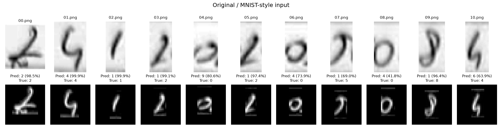

# Kendi el yazısı değerlendirmesi

- Model: `results\main\checkpoints\wide.pt`
- Görsel sayısı: 11
- Tahmin edilen numara: `24119141416`
- Gerçek numara: `24120205084`
- Rakam accuracy: 27.27%
- Numaranın tamamı doğru mu: Hayır

| Dosya | Gerçek | Tahmin | Softmax skoru |
|---|---:|---:|---:|
| 00.png | 2 | 2 | 98.45% |
| 01.png | 4 | 4 | 99.88% |
| 02.png | 1 | 1 | 99.90% |
| 03.png | 2 | 1 | 99.15% |
| 04.png | 0 | 9 | 80.64% |
| 05.png | 2 | 1 | 97.38% |
| 06.png | 0 | 4 | 73.94% |
| 07.png | 5 | 1 | 69.02% |
| 08.png | 0 | 4 | 41.76% |
| 09.png | 8 | 1 | 96.41% |
| 10.png | 4 | 6 | 63.87% |

Softmax skoru kalibre edilmiş doğruluk garantisi değildir. Az sayıdaki kişisel rakam sonucu, MNIST'in 10.000 test örneğiyle doğrudan eşdeğer bir başarı ölçümü değildir. Yanlış tahminlerde orijinal ve işlenmiş görüntüleri karşılaştırın: kırpma, gölge, çizgi kalınlığı, rakam şekli ve merkezleme etkili olabilir. Bu örnekleri kullanarak yapılan ek ayarlar sonrası aynı görseller bağımsız test sayılmaz.
