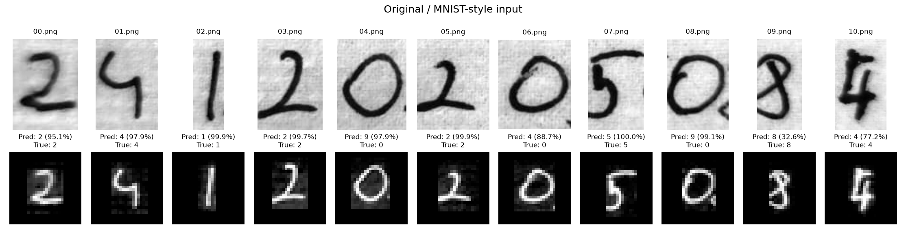

# Kendi el yazısı değerlendirmesi

- Model: `results\main\checkpoints\wide.pt`
- Görsel sayısı: 11
- Tahmin edilen numara: `24129245984`
- Gerçek numara: `24120205084`
- Rakam accuracy: 72.73%
- Numaranın tamamı doğru mu: Hayır

| Dosya | Gerçek | Tahmin | Softmax skoru |
|---|---:|---:|---:|
| 00.png | 2 | 2 | 95.07% |
| 01.png | 4 | 4 | 97.91% |
| 02.png | 1 | 1 | 99.91% |
| 03.png | 2 | 2 | 99.70% |
| 04.png | 0 | 9 | 97.93% |
| 05.png | 2 | 2 | 99.91% |
| 06.png | 0 | 4 | 88.74% |
| 07.png | 5 | 5 | 99.96% |
| 08.png | 0 | 9 | 99.10% |
| 09.png | 8 | 8 | 32.55% |
| 10.png | 4 | 4 | 77.15% |

Softmax skoru kalibre edilmiş doğruluk garantisi değildir. Az sayıdaki kişisel rakam sonucu, MNIST'in 10.000 test örneğiyle doğrudan eşdeğer bir başarı ölçümü değildir. Yanlış tahminlerde orijinal ve işlenmiş görüntüleri karşılaştırın: kırpma, gölge, çizgi kalınlığı, rakam şekli ve merkezleme etkili olabilir. Bu örnekleri kullanarak yapılan ek ayarlar sonrası aynı görseller bağımsız test sayılmaz.
