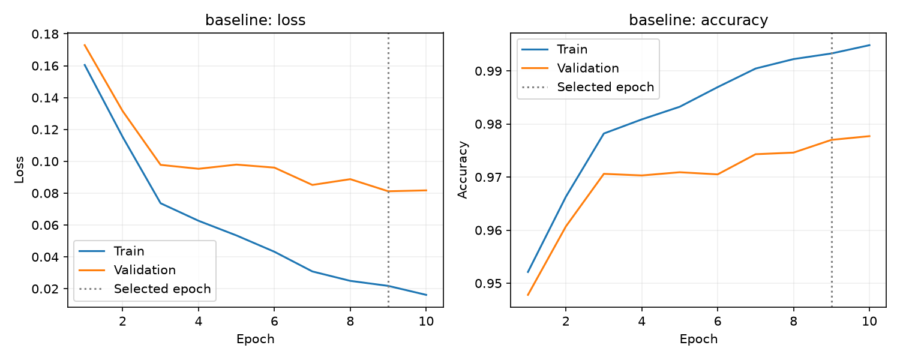
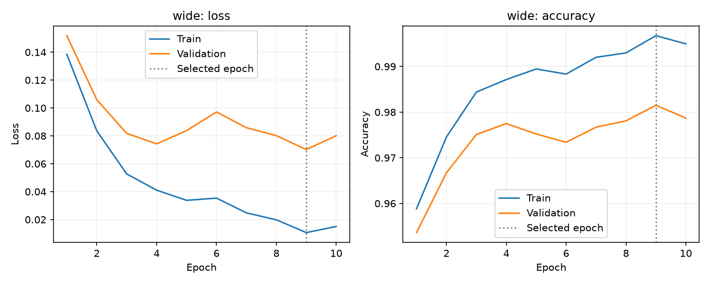
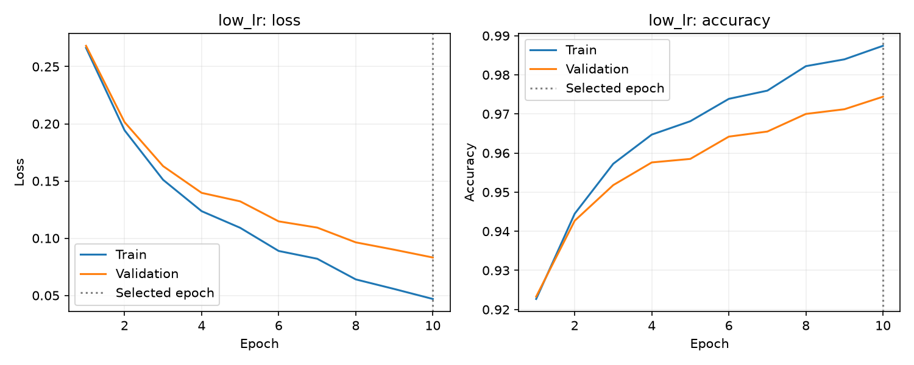
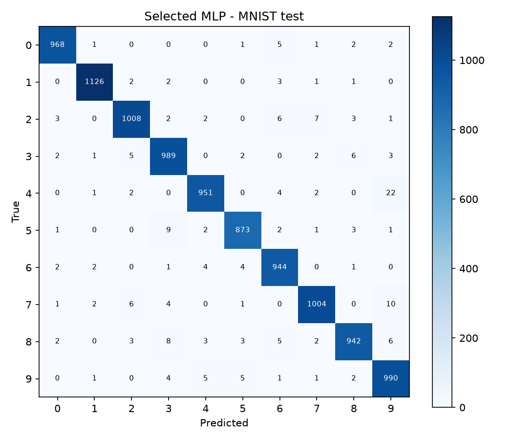

# MNIST MLP — Deney Raporu

Bu dosya gerçek eğitim çıktılarından otomatik oluşturulmuştur.

## Yöntem

- Veri ayrımı: 49999 train / 10001 validation / 10000 test.
- Seed: 42; cihaz: cpu; işlemci: Intel64 Family 6 Model 154 Stepping 3, GenuineIntel.
- Train üzerinden hesaplanan normalizasyon: mean=0.130728, std=0.308191.
- Stratified ayrım indeksleri split_indices.npz dosyasındadır. Validation ve test normalizasyon istatistiklerine katılmaz.
- Tüm ağlar sıfırdan eğitildi: Flatten → Linear → ReLU → Linear → ReLU → Linear(10). CNN kullanılmadı.
- CrossEntropyLoss ham logits alır. Accuracy doğru tahmin sayısı / örnek sayısıdır; loss olasılık hatasını da yansıtır.
- Her deneyde en düşük validation loss görülen epoch kaydedildi. Deney seçimi de yalnızca bu loss ile yapıldı.
- Bütün yapılandırmalar ve seçilen model test değerlendirmesinden önce sabitlendi (selection.json). Test sonuçları ile ayar yapılmadı.
- Train/validation metrikleri epoch sonunda aynı ağırlıklarla ölçülür. Tablodaki değerler seçilen epoch'a aittir; son epoch ayrıca results.json içinde bulunur.
- Süre eğitim döngüsü, her epoch train/validation ölçümü ve checkpoint yazımını içerir; indirme, son test ve grafik çizimi dahil değildir.

## Hiperparametreler

| Deney | Hidden katmanlar | Optimizer | LR | Batch | Epoch |
|---|---|---|---|---|---|
| baseline | [128, 64] | Adam | 0.001 | 128 | 10 |
| wide | [256, 128] | Adam | 0.001 | 128 | 10 |
| low_lr | [128, 64] | Adam | 0.0003 | 128 | 10 |

## Ölçülen sonuçlar

| Deney | Parametre | Epoch | Train loss | Val loss | Train acc | Val acc | Test acc | Süre (s) |
|---|---:|---:|---:|---:|---:|---:|---:|---:|
| baseline | 109386 | 9 | 0.0218 | 0.0812 | 99.33% | 97.70% | 97.56% | 75.7 |
| wide | 235146 | 9 | 0.0106 | 0.0702 | 99.68% | 98.15% | 97.95% | 31.2 |
| low_lr | 109386 | 10 | 0.0469 | 0.0831 | 98.74% | 97.44% | 97.44% | 14.0 |

## Genel değerlendirme

Validation loss ölçütüne göre seçilen model **wide**, epoch **9** oldu. Train–validation accuracy farkı 1.53 yüzde puan; ayrılmış test kümesindeki accuracy 97.95%.

wide deneyi yalnızca katman genişliklerini; low_lr deneyi yalnızca öğrenme oranını baseline'a göre değiştirir. Daha fazla parametre daha yüksek kapasite ve hesaplama maliyeti getirir. Daha düşük LR aynı epoch bütçesinde daha yavaş yakınsayabilir. Yorum tablodaki ölçümlerle birlikte yapılmalıdır; tek seed ile yapılan deney istatistiksel üstünlük kanıtı değildir. Süreler tek koşunun duvar saati ölçümüdür; süreç ısınması ve sistem yükü süreyi etkiler. Bu çalışma mimarileri hız açısından sıralayan kontrollü, tekrarlanmış bir benchmark değildir. Train loss düşerken validation loss artıyorsa overfitting işaretidir; seçilen checkpoint son epoch olmak zorunda değildir.

wide için baseline'a göre validation accuracy farkı +0.45 yüzde puan, validation loss farkı -0.0110. Bu sonuç aynı epoch bütçesi ve tek seed koşullarına aittir.

low_lr için baseline'a göre validation accuracy farkı -0.26 yüzde puan, validation loss farkı +0.0020. Bu sonuç aynı epoch bütçesi ve tek seed koşullarına aittir.

## Grafikler

## Kendi el yazısı değerlendirmesi

Öğrencinin sağladığı fotoğraf 11 ayrı rakam görseline kırpıldı. Gerçek numara kullanıcı tarafından **24120205084** olarak doğrulandı. Seçilen wide modeli yeniden eğitilmeden kullanıldı. Tahmin **24129245984**; rakam accuracy **8/11 = 72.73%**; tam eşleşme: hayır.

MNIST test accuracy 97.95% iken bu tek fotoğraftaki başarı 72.73% oldu. Bu ölçümler farklı dağılım ve örnek büyüklüklerine aittir; bu kadar az rakam genel gerçek dünya başarısını tahmin etmek için yeterli değildir. Işık, yüzey dokusu, kontrast, yazı biçimi, kırpma ve ölçekleme sonucu etkileyebilir. Bu sonuç hem kırpma/ön işleme hem sınıflandırma aşamalarını içeren tüm akışın performansıdır. Bu fotoğrafa özgü gözlemler ve önceki çekimle karşılaştırma aşağıdaki değerlendirme dosyasındadır.

[Rakam bazında sonuçlar ve değerlendirme](../handwritten_v2/handwritten_evaluation.md)

[Fotoğrafa ilişkin gözlemler](../handwritten_v2/observations.md)

